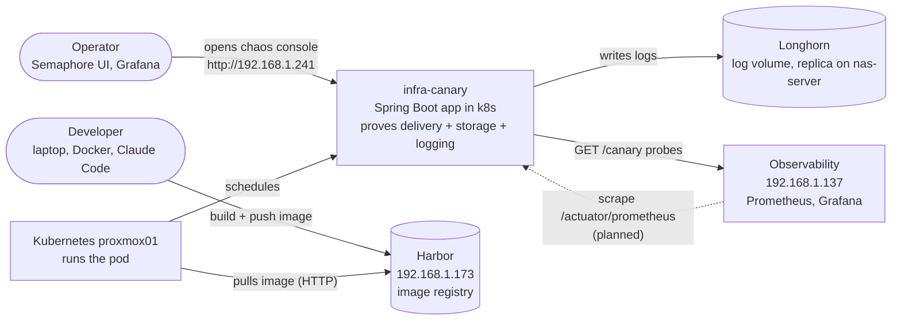
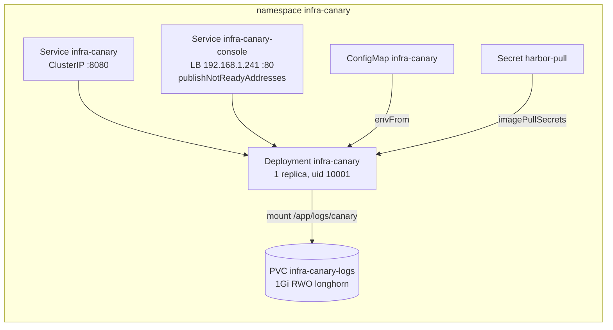
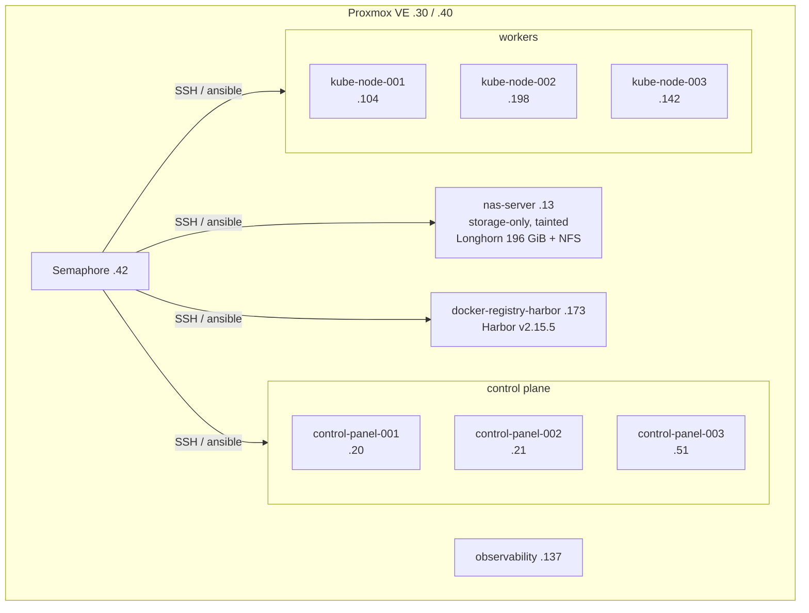
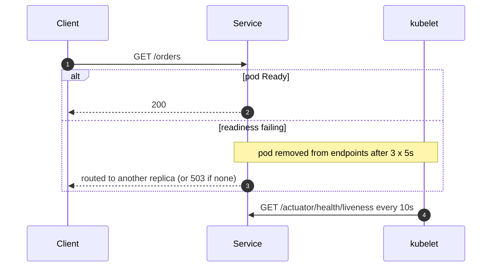
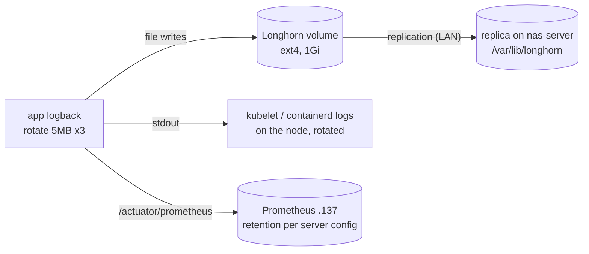
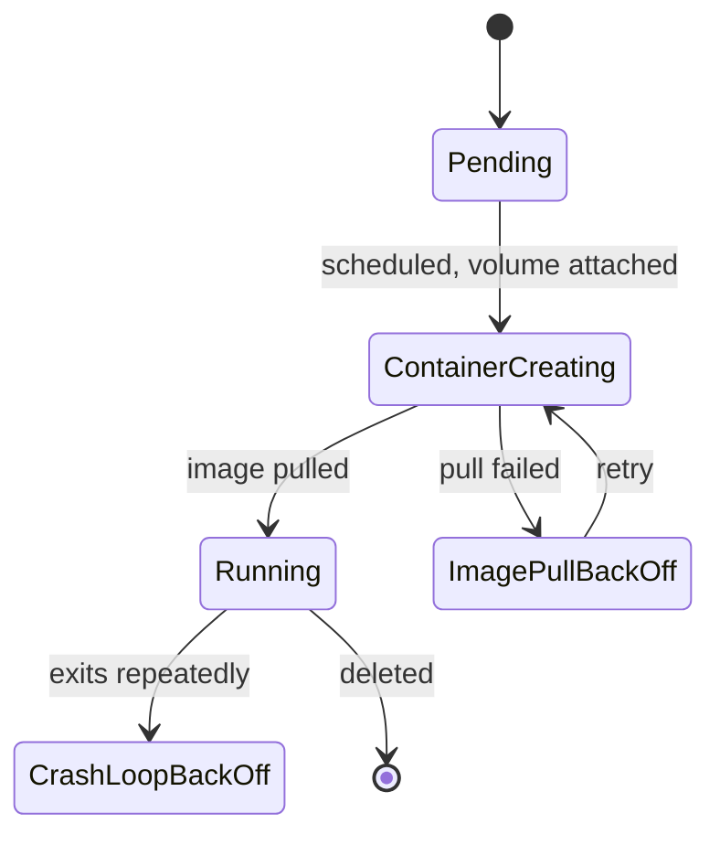

# Diagram templates (ai-labs)

Copy a template, then replace the example content with verified facts. Contents:

1. Context (C4 L1)
2. Container (C4 L2)
3. Deployment
4. Sequence
5. Data flow
6. State

---

## 1. Context — "what is it, who uses it, what does it depend on"

System of interest in the middle, people on the left, dependencies on the right. System-level boxes
only — no pods, no ports unless they define the integration.

## 2. Container — "what runs inside, how the parts talk"

One subgraph per runtime boundary (VM, namespace). Show protocols and ports on arrows.

## 3. Deployment — "which machine hosts what"

Nest physical/virtual hosts → VMs → cluster roles. Addresses on every host.

## 4. Sequence — "what happens, in order"

Use for delivery pipelines, request paths, failure handling. `alt` for branches, `Note` for the
non-obvious rule that makes it work.

## 5. Data flow — "where does data go and where does it rest"

Stores as cylinders; label each hop with format/protocol and retention if relevant.

## 6. State — "what states does it move through"

