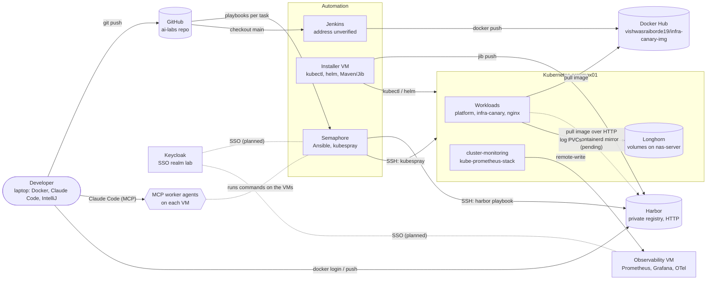
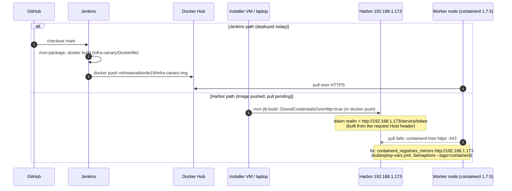
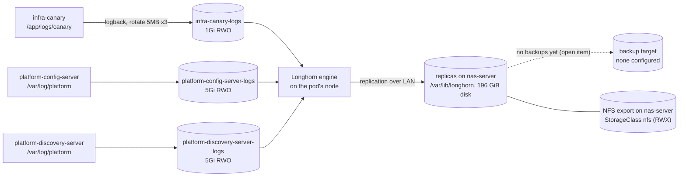
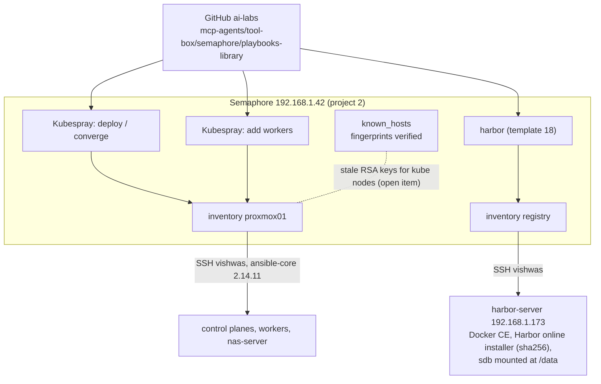
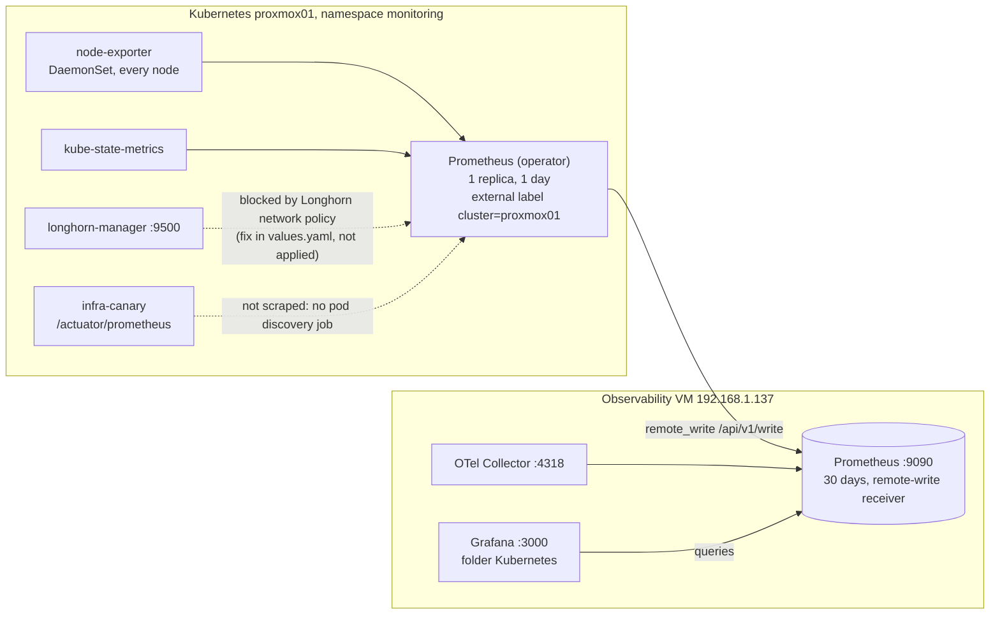
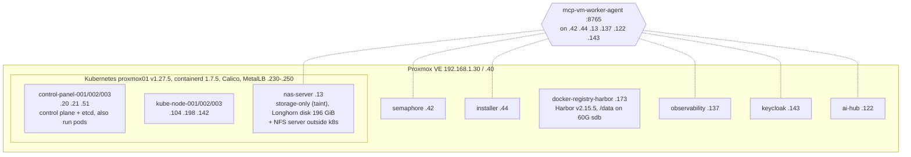

# ai-labs architecture

How the lab's systems fit together: what exists now, why it is like this ([decisions](adr/)), and what is
about to change ([open items](#open-items), [designs](designs/)). Operating one system is in its runbook,
linked from the [systems table](#systems); building one project is in its own README.

**State as of 2026-11-14**, verified against the inventories, `kubectl` on the cluster and the
Semaphore database that day.

**Legend** for every diagram: solid arrow = applied and working; dashed arrow = configured in the repo but
not applied, planned, or broken (the label says which).

---

## 1. Context

Who talks to what. Addresses and versions are in the [systems table](#systems).

## 2. Key flows

### 2.1 Image delivery: source → registry → pod

Two paths exist today ([open item](#open-items): choose the canonical one). The cluster currently runs the
Docker Hub image; pulling from Harbor waits for the containerd mirror ([ADR 0001](adr/0001-run-harbor-over-plain-http-on-a-dedicated-vm.md),
[design](designs/2026-11-cluster-pulls-from-harbor.md)).

### 2.2 Logs and storage: app → Longhorn → NAS disk

Every Longhorn volume has **one replica, on nas-server** ([ADR 0002](adr/0002-keep-longhorn-data-on-a-storage-only-nas-node.md)).
Apps write log files to their own PVC as well as stdout ([ADR 0005](adr/0005-apps-write-log-files-to-per-app-longhorn-volumes.md)).

### 2.3 Provisioning: Semaphore

All node and VM changes go through Semaphore playbooks from this repo
([ADR 0003](adr/0003-provision-through-semaphore-with-pinned-kubespray-and-ansible-core.md)).

Task CLI args are **appended** to the template's: enter only `--limit=…` / `--tags=…`.

### 2.4 Observability

In-cluster Prometheus forwards everything to the central one
([ADR 0004](adr/0004-forward-cluster-metrics-to-a-central-prometheus.md)).

## 3. Deployment

Which machine hosts what.

## Systems

| System | Address | Role | Managed by |
|---|---|---|---|
| GitHub `ai-labs` | github.com/vishwasraiborde19/ai-labs | source of truth; Semaphore and Jenkins pull from it | — |
| Semaphore UI 2.19 | http://192.168.1.42:3000 | runs Ansible: kubespray, Harbor; PostgreSQL inside | [semaphore-installer](../mcp-agents/tool-box/semaphore/semaphore-installer/), [admin runbook](../mcp-agents/tool-box/semaphore/admin/runbooks.md) |
| Installer VM | 192.168.1.44 | kubectl/helm to the cluster, Jib builds (no Docker) | manual |
| Jenkins | **unverified** (not in catalog) | builds infra-canary, pushes to Docker Hub | [Jenkinsfile](../infra-canary/Jenkinsfile) |
| Docker Hub | `vishwasraiborde19/infra-canary-img` | image the cluster runs for infra-canary today | Jenkins |
| Harbor v2.15.5 + Trivy | http://192.168.1.173 (HTTP) | private registry; project `infracanary` | [registry playbook](../mcp-agents/tool-box/semaphore/playbooks-library/registry/), [runbook](../mcp-agents/tool-box/harbour/runbook.md) |
| Control plane | 192.168.1.20, .21, .51 | apiserver :6443, etcd; schedulable | [kubespray inventory](../mcp-agents/tool-box/semaphore/playbooks-library/kubernetes/) |
| Workers | 192.168.1.104, .198, .142 | workloads | kubespray |
| nas-server | 192.168.1.13 | Longhorn storage-only node + NFS server | [nfs-installer](../mcp-agents/tool-box/nfs/nfs-installer/), [longhorn](../mcp-agents/tool-box/kube/longhorn/) |
| Longhorn 1.12.2 UI | http://192.168.1.240 | volumes, replicas, snapshots | [longhorn](../mcp-agents/tool-box/kube/longhorn/) |
| cluster-monitoring | namespace `monitoring` | kube-prometheus-stack 93.3.0 → central Prometheus | [cluster-monitoring](../mcp-agents/tool-box/kube/cluster-monitoring/) |
| platform-config-server | LB 192.168.1.231:9001 | Spring Cloud Config (ns `platform`) | platform-cloud2 repo |
| platform-discovery-server | LB 192.168.1.232:8761 | Eureka (ns `platform`) | platform-cloud2 repo |
| nginx (test) | LB 192.168.1.230 | sample deployment in `default` | — |
| infra-canary | ClusterIP; console LB 192.168.1.241 **reserved, not applied** | delivery/storage canary + chaos console | [infra-canary](../infra-canary/) |
| Observability | 192.168.1.137 | Prometheus :9090, Grafana :3000, OTel :4318 | [grafana-installer](../mcp-agents/tool-box/observability-monitoring/grafana-installer/) |
| Keycloak | https://192.168.1.143:8443 | SSO realm `lab` | [keycloak-installer](../mcp-agents/tool-box/keycloak/keycloak-installer/) |
| ai-hub | 192.168.1.122 | AI tooling VM | mcp-vm-worker-agent |
| MCP worker agents | `http://<vm>:8765/mcp` on .42 .44 .13 .137 .122 .143 | Claude Code runs commands/files/jobs on VMs | [mcp-vm-worker-agent](../mcp-agents/vm/mcp-vm-worker-agent/) |
| Proxmox VE | https://192.168.1.30:8006, https://192.168.1.40:8006 | hypervisors for every VM | manual |
| Old Harbor | 192.168.1.34 | **Retired** 2026-11-14 (VM broke); replaced by .173 | — |

MetalLB pool `192.168.1.230–250`: in use .230 .231 .232 .240; .241 reserved for the canary console.

## Decisions

| ADR | Decision |
|---|---|
| [0001](adr/0001-run-harbor-over-plain-http-on-a-dedicated-vm.md) | Run Harbor over plain HTTP on a dedicated VM |
| [0002](adr/0002-keep-longhorn-data-on-a-storage-only-nas-node.md) | Keep Longhorn data on a storage-only NAS node |
| [0003](adr/0003-provision-through-semaphore-with-pinned-kubespray-and-ansible-core.md) | Provision through Semaphore with pinned kubespray and ansible-core |
| [0004](adr/0004-forward-cluster-metrics-to-a-central-prometheus.md) | Forward cluster metrics to a central Prometheus |
| [0005](adr/0005-apps-write-log-files-to-per-app-longhorn-volumes.md) | Apps write log files to per-app Longhorn volumes |
| [0006](adr/0006-build-fault-injection-into-infra-canary-off-by-default.md) | Build fault injection into infra-canary, off by default |

## Open items

| Item | Effect until done | How |
|---|---|---|
| containerd HTTP mirror for Harbor on all nodes | cluster can't pull from Harbor (`:443 connection refused`) | [design](designs/2026-11-cluster-pulls-from-harbor.md); Semaphore *Kubespray: deploy / converge* `--tags=containerd` |
| Choose the canonical image path (Harbor vs Jenkins → Docker Hub) | two registries, two build paths, the deployment manifest follows whichever was applied last | decide, record as ADR 0007, align `infra-canary/k8s/30-deployment.yaml` and the Jenkinsfile |
| No Longhorn backup target; 1 replica per volume | losing nas-server's disk loses every volume | set a backup target off the NAS (see [ADR 0002](adr/0002-keep-longhorn-data-on-a-storage-only-nas-node.md)) |
| Deploy infra-canary 0.2.0 + console Service (.241) | chaos console not reachable | build/push image, `kubectl apply -f infra-canary/k8s/` |
| Longhorn `networkPolicies.metricsScrapeSources` | no Longhorn metrics in Grafana | `install-longhorn.sh` (helm upgrade) on the installer VM |
| App metrics scrape (`/actuator/prometheus`) | canary/platform metrics not in Prometheus | PodMonitor/ServiceMonitor for kube-prometheus-stack |
| Stale SSH host keys for kube nodes (Semaphore, installer) | SSH to .104 refused | verify fingerprints out of band, then replace |
| Rotate Harbor robot secrets shared in chat | exposure | Harbor → robot → *Refresh secret*; update `harbor-pull` Secrets |
| Jenkins address not recorded | can't link or monitor it | add to `command-center` seed catalog and this table |
| Keycloak SSO for Semaphore and Grafana | separate logins | planned |
| Kubernetes 1.27 is past end of life | no security patches; upgrade gets harder | plan kubespray upgrade path (design doc) |
