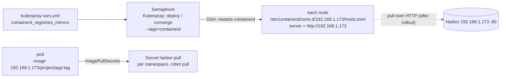

# Cluster pulls images from Harbor

- **Status:** Agreed, in progress (step 2 not yet run)
- **Author / date:** vishwas + Claude / 2026-11-14
- **Related:** [ADR 0001](../adr/0001-run-harbor-over-plain-http-on-a-dedicated-vm.md), [Harbor runbook](../../mcp-agents/tool-box/harbour/runbook.md) §3–4, [kubespray-vars.yml](../../mcp-agents/tool-box/semaphore/playbooks-library/kubernetes/inventories/proxmox01/kubespray-vars.yml)

## 1. Summary

Make every proxmox01 node pull images from Harbor (192.168.1.173, plain HTTP) with per-namespace pull
secrets, so lab images stay inside the lab. Outcome: `192.168.1.173/infracanary/infra-canary:0.2.0` runs
in the cluster.

## 2. Context and problem

Images reach Harbor (Jib from the installer VM, `docker push` from the laptop), but nodes fail with
`Head "https://192.168.1.173/v2/…": dial tcp 192.168.1.173:443: connect: connection refused`: containerd
1.7.5 defaults to HTTPS. The infra-canary Deployment currently uses a Docker Hub image built by Jenkins
as a workaround.

## 3. Goals and non-goals

- Goals: every schedulable node pulls from `192.168.1.173` over HTTP; private projects work with
  `imagePullSecrets`; the setting is in the repo and reapplied by kubespray.
- Non-goals: TLS for Harbor (see ADR 0001 follow-ups); deciding Harbor vs Docker Hub as the canonical path
  (separate decision, ADR 0007).

## 4. Proposed design

- `containerd_registries_mirrors` keeps docker.io as is and adds prefix `192.168.1.173` →
  `http://192.168.1.173` with `pull, resolve` (already committed).
- Credentials: a pull-only robot per project where possible; Secret `harbor-pull` created per namespace
  from stdin, never committed.

## 5. Quality attributes

| Attribute | Approach |
|---|---|
| Availability | containerd restart per node; running pods keep running. Harbor down = new pulls fail; cached images still start (`IfNotPresent`) |
| Security | HTTP on LAN only (accepted, ADR 0001); robot secrets in Kubernetes Secrets and the password manager |
| Operability | reapplied by every kubespray converge; verify with `crictl pull` on the node |

## 6. Alternatives considered

| Option | Why not |
|---|---|
| Hand-edit `hosts.toml` on each node | drifts; next kubespray run may overwrite it |
| Keep Docker Hub for lab images | images leave the lab; rate limits |
| TLS on Harbor | needs a CA rollout (out of scope) |

## 7. Rollout and rollback

1. `git push` the branch with `kubespray-vars.yml` (Semaphore pulls from GitHub).
2. Semaphore *Kubespray: deploy / converge*, CLI args `--tags=containerd --limit=kube-node-002`.
3. Verify on that node: `sudo crictl pull --creds 'robot$…:<secret>' 192.168.1.173/infracanary/infra-canary:0.2.0`.
4. Repeat without `--limit` for all nodes.
5. Point `infra-canary/k8s/30-deployment.yaml` at the Harbor image, apply, confirm the pod pulls.

Rollback: remove the Harbor entry from `containerd_registries_mirrors` and rerun step 2/4; switch the
Deployment image back to Docker Hub. Steps 2 and 4 restart containerd on shared nodes — confirm before running.

## 8. Risks and open questions

| Risk | Mitigation |
|---|---|
| Semaphore's stale RSA host keys for kube nodes block the run | verify fingerprints out of band first |
| `--tags=containerd` also changes other containerd settings | review the task diff on the first node |
| Which path is canonical (Harbor or Jenkins → Docker Hub)? | ADR 0007 before switching the Deployment |

## 9. Docs to update when built

[arch/README.md](../README.md): flip the Harbor pull arrow to solid, remove the open item, update §2.1;
Harbor runbook §3 status.
