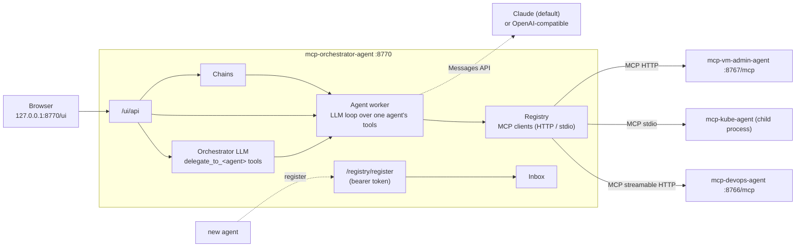

# mcp-orchestrator-agent

A control room for a team of MCP agents (Java 21, Spring Boot 3.5). Every agent appears as a person on a
tile: face, name, role, what it is doing now, and its tools. From the web UI you can:

- **give one agent a task**: its LLM works the task with that agent's MCP tools and standing instructions;
- **give the team a goal**: the orchestrator's LLM splits it into directives and delegates them to agents;
- **plan first**: the orchestrator drafts a chain of steps you edit, then run or save;
- **build chains**: saved, ordered steps across agents, each one able to use the previous step's output;
- **call any tool directly**: a form generated from the tool's schema, no LLM involved;
- **approve risky calls**: chosen tools pause the run until you click Approve;
- **grow the team**: register agents in the UI, with drop-in files, by self-registration or by discovery,
  and see every agent's tool catalogue (refreshed every minute; changes are flagged).



## Build and run

Needs JDK 21 and Maven 3.9+.

```bash
mvn -q package                                   # runs the unit tests, produces target/mcp-orchestrator-agent.jar
export ANTHROPIC_API_KEY=sk-ant-...              # or paste a key in Settings, or `ant auth login`
java -jar target/mcp-orchestrator-agent.jar      # http://127.0.0.1:8770/ui
```

To run the whole local stack (devops agent on 8766, kube agent on 8768, orchestrator on 8770) in one go,
with tokens generated and both agents registered for you, use [`../agents.sh`](../agents.sh):

```bash
../agents.sh start            # builds missing jars; also: stop, restart, status, logs [agent...], --build
```

The UI accepts only clients on this machine and has no sign-in; from elsewhere use
`ssh -L 8770:127.0.0.1:8770 host`. API calls need an `X-Orchestrator: 1` header (CSRF protection), and a
strict Content-Security-Policy applies.

## Add your agents

**In the UI:** Team → Add agent.

| Transport | Use it for | What you enter |
|---|---|---|
| HTTP | an agent that runs on its own (`--spring.profiles.active=http`) | MCP URL and bearer token |
| stdio | an agent the orchestrator should start itself | the command, e.g. `java -jar /opt/agents/mcp-kube-agent.jar` |

For the agents in this repo:

```bash
# devops agent over HTTP
export DEVOPS_AGENT_TOKEN=$(openssl rand -base64 32)
java -jar ../mcp-devops-agent/target/mcp-devops-agent.jar --spring.profiles.active=http      # 127.0.0.1:8766/mcp

# kube agent over stdio: command = java -jar /full/path/mcp-kube-agent/target/mcp-kube-agent.jar
# (its HTTP profile also defaults to port 8767, the same as the VM control centre; set KUBE_AGENT_PORT if you run both)

# VM control centre: URL http://127.0.0.1:8767/mcp, token = contents of ~/.vm-admin/mcp.token
```

**Drop-in files:** a YAML file in `~/.orchestrator/agents.d/` (one agent or a list) is picked up within a
minute, with no restart. Examples: [config/agents.d/](config/agents.d/). Agents edited in the UI move to
`agents.yml`; to remove a drop-in agent, delete its file.

**Self-registration:** set `orchestrator.registration.token-ref` (e.g. `env:ORCHESTRATOR_REGISTRATION_TOKEN`)
and `ORCHESTRATOR_HOST` so agents can reach the orchestrator. An agent, or its install script, then calls:

```bash
curl -X POST http://orchestrator:8770/registry/register \
  -H "Authorization: Bearer $REGISTRATION_TOKEN" -H "Content-Type: application/json" \
  -d '{"id":"devops","name":"Dev","role":"CI/CD engineer","url":"http://10.0.0.7:8766/mcp","token":"<agent token>","tags":["jenkins"]}'
```

The orchestrator connects, lists the tools and puts the agent in the **Registry → Inbox**. It joins the team
only when you approve it, because its tool descriptions go into LLM prompts. Calling again with the same URL
counts as a heartbeat. Self-registered agents are always HTTP: a remote caller never chooses a local command.

**Discovery:** `orchestrator.discovery.urls` in `config.yml` lists MCP endpoints to probe on every refresh.
New servers that answer land in the inbox.

## Systems: which agent reaches which cluster, server or VM

Every minute the orchestrator asks each online agent what it is connected to, by calling the agent's own
listing tool directly (no LLM, no cost). Every 5 minutes it runs a health check per system.

| Agent offers | Systems found | Health check | Quick actions |
|---|---|---|---|
| `k8s_clusters` (kube agent) | Kubernetes clusters, with API server and policy (read-only, namespaces) | `k8s_whoami`: version and service account | Nodes, Health sweep, Top pods |
| `devops_list_resources` (devops agent) | Jenkins servers, Docker Hub accounts, clusters | none | Jobs, Deployments |
| `fleet_hosts` (VM control centre) | VMs with their live state | state from the list | System info |

What this gives you:

- **Systems page:** every system the team can reach. Two agents reaching the same endpoint (e.g. the kube
  agent and the devops agent on the same API server) appear as one system with both agents listed.
  Each entry has a status and quick actions (one tool call, no LLM), and **Ask** opens a task for that agent
  already naming the system.
- **Tiles** show each agent's systems as chips with a status dot.
- **Agents know their systems:** each agent's system prompt lists the systems it can reach, with the names to
  use in tool arguments, so it no longer spends a turn finding them.
- **The orchestrator routes by system:** the roster lists each agent's systems, and the orchestrator is told
  to give work on a system to an agent that reaches it. On the Mission page, **Focus on a system** picks
  those agents and names the system in the goal.

For a new kind of agent, open its **Systems** tab, untick *Automatic* and describe the probes (or put
`systems:` in its agents.yml / drop-in entry):

```yaml
systems:
  - kind: database
    list-tool: db_list_instances      # must return a JSON list of objects (list-path: field.inside if nested)
    name-field: name
    health-tool: db_ping              # called as {health-arg: <name>}
    health-arg: instance
    actions:
      - {label: Slow queries, tool: db_slow_queries, args: {instance: "{{system}}", limit: 20}}
```

The systems an agent can reach are still decided by that agent's own config (e.g. `~/.kube-agent/config.yml`
for clusters); the orchestrator only discovers and uses them.

## Instructions, models and approvals

Each agent's **Instructions** tab holds:

| Setting | Effect |
|---|---|
| Standing instructions | added to the agent's system prompt on every task, however the task arrives |
| LLM provider / model / effort | which LLM drives this agent (default: Settings) |
| Ask me before these tools run | glob patterns (`k8s_delete`, `*_rollback`); the run waits for Approve or Deny in the UI (30 min timeout, then denied) |
| Hide these tools from the LLM | glob patterns; you can still run them yourself from the Tools tab |

The agent's own policy still applies underneath: read-only clusters, protected namespaces and RBAC in the
kube agent, `read-only` Jenkins servers in the devops agent, and so on.

**Settings** holds the LLM providers and the orchestrator's and planner's system prompts:

| Provider type | Notes |
|---|---|
| `anthropic` (default) | official Anthropic Java SDK. Default model `claude-opus-5-5` at effort `high`. Key: blank uses `ANTHROPIC_API_KEY` or an `ant auth login` profile; or paste one (stored as `store:llm.<name>`) or give `env:` / `path:`. The refusal fallback (`fallbacks: "default"`) is on for models that support it; untick it to turn it off. |
| `openai` | any OpenAI-compatible `/chat/completions` API (Ollama, vLLM, LM Studio, LiteLLM) for local models. Tool calling quality depends on the model. |

## How a mission runs

1. The orchestrator LLM gets the goal, the roster (each agent's role, bio, tool names and server notes) and one
   tool per agent: `delegate_to_<agent>(task)`.
2. Each delegation runs that agent's own loop: its LLM, its MCP tools, its standing instructions.
   Tool output over 60,000 characters is cut, and the LLM is told so.
3. Reports go back to the orchestrator, which delegates further or writes the summary.

Every step shows up live on the run's timeline: directives, what each agent says, tool calls and results,
approvals. Runs can be cancelled at any point. In chains, `{{input}}`, `{{prev}}` and `{{stepN}}` are
replaced in step tasks and in tool arguments (JSON-escaped there).

## Files

All in `~/.orchestrator` (`ORCHESTRATOR_HOME`):

| File | Holds |
|---|---|
| `config.yml` | server and registry settings, read at startup ([example](config/config.example.yml)) |
| `agents.yml`, `agents.d/*.yml` | the team |
| `pending.yml` | the registry inbox |
| `settings.yml` | LLM providers and orchestrator prompts |
| `chains.yml` | saved chains |
| `tokens.yml` (600) | pasted agent tokens and API keys, referenced as `store:<key>` |
| `runs/*.json` | the last 300 runs with their timelines |
| `logs/orchestrator.log`, `logs/audit.log` | app log; every delegation, tool call, approval and registry change |

Secret references work like in the other agents: `env:NAME`, `path:/file`, `store:key`. Tokens are never
returned to the browser or to an LLM.

## API

Everything the UI does is under `/ui/api` (loopback, `X-Orchestrator: 1`):

| Method | Path | |
|---|---|---|
| GET | `/agents`, `/agents/{id}` | team with live state and tool catalogues |
| POST, PUT, DELETE | `/agents`, `/agents/{id}` | `{agent, token}` |
| POST | `/agents/probe` | test a connection before saving |
| POST | `/agents/{id}/refresh` | reconnect and reload tools |
| POST | `/agents/{id}/delegate` | `{task}` → `{runId}` |
| POST | `/agents/{id}/tools/{tool}` | `{args}` → `{runId}` |
| POST | `/missions` | `{goal, mode: orchestrate\|plan, agents?}` → `{runId}` |
| GET, POST, PUT, DELETE | `/chains`, `/chains/{id}` | saved chains |
| POST | `/chains/run` | `{chain, input}` → `{runId}` |
| GET | `/runs`, `/runs/{id}?after=<seq>` | history; one run with events after `seq` |
| POST | `/runs/{id}/cancel`, `/runs/{id}/approvals/{approval}` | `{approve: true\|false}` |
| GET, POST, DELETE | `/registry/pending`, `/registry/pending/{id}/approve` | the inbox |
| GET | `/systems` | every system, merged across agents, with status and quick actions |
| POST | `/systems/check?agent=` | re-discover and health-check now |
| GET, PUT | `/settings` | `{settings, apiKeys}` |

## Limits

- Delegation is one level deep: the orchestrator delegates to agents, agents do not delegate to each other.
- Delegations in one orchestrator turn run one after another.
- MCP features beyond tools (resources, prompts, sampling) are not used.
