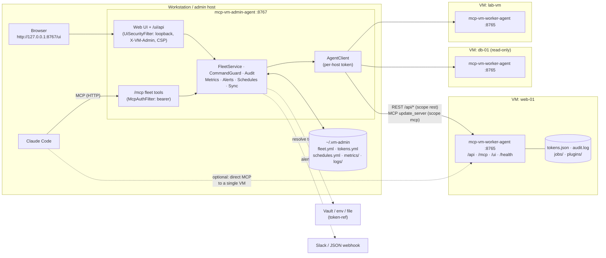
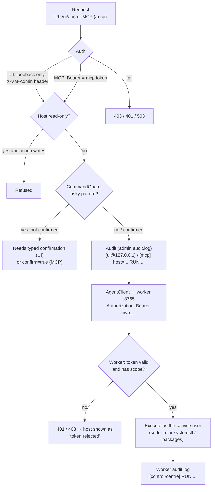
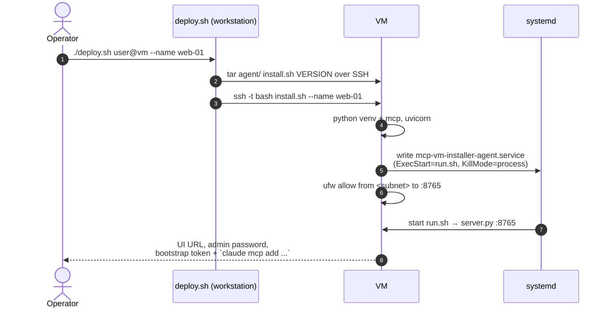
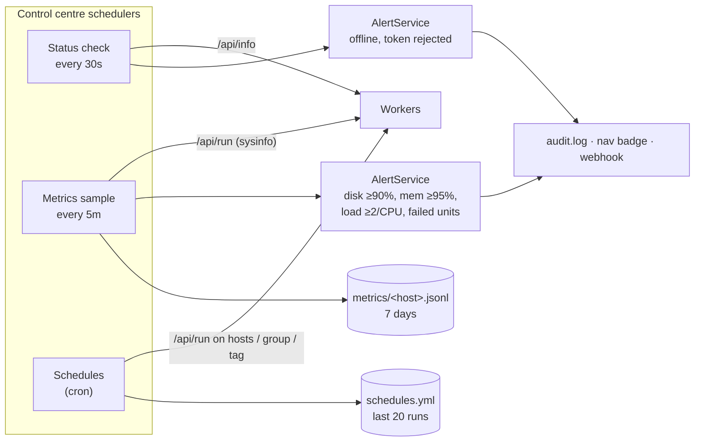
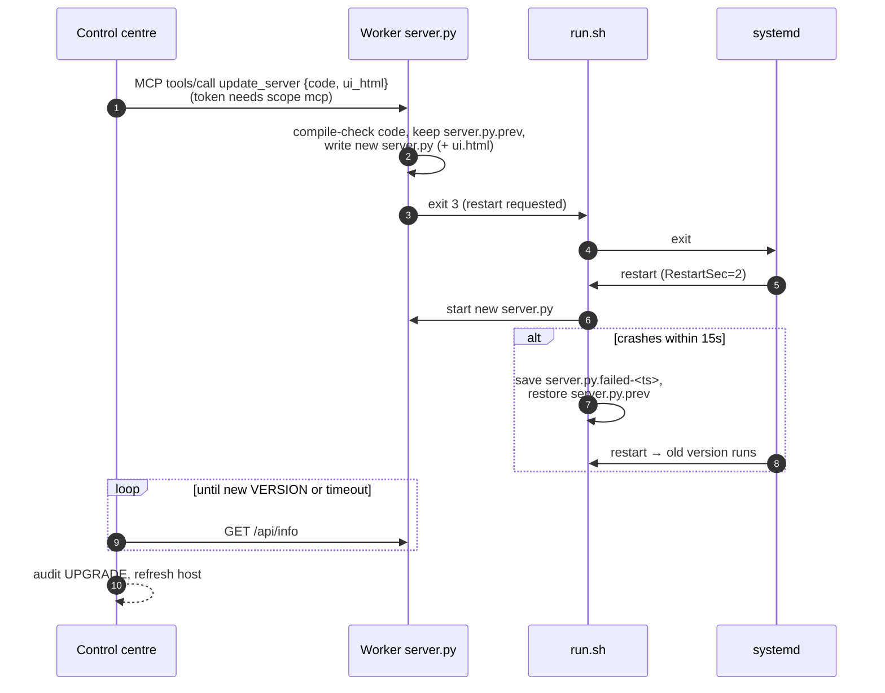
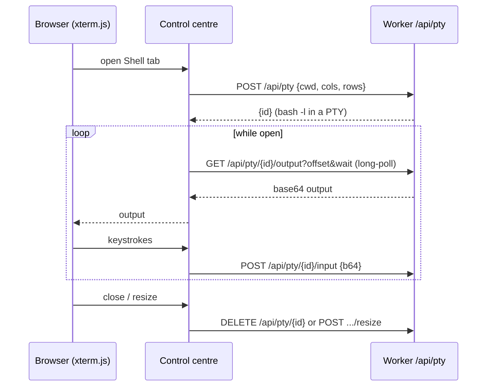

# VM management

Two components that together let you (in a browser) and Claude Code (over MCP) operate a fleet of
Linux VMs: run commands and jobs, browse and edit files, open a shell, manage services and packages,
tail logs, and watch metrics and alerts.

| Component | Runs on | Stack | Port | Docs |
|---|---|---|---|---|
| [mcp-vm-worker-agent](mcp-vm-worker-agent/) | every VM | Python (FastMCP + uvicorn), systemd | `8765` | [README](mcp-vm-worker-agent/README.md) |
| [mcp-vm-admin-agent](mcp-vm-admin-agent/) | your workstation / admin host | Java 21, Spring Boot | `8767` (loopback) | [README](mcp-vm-admin-agent/README.md) |

The **worker** is a small agent on each VM with an MCP endpoint, a REST API and a token-management UI.
The **admin** (control centre) holds the fleet list and one token per VM, and turns the workers'
REST APIs into a single UI and a fleet-wide MCP endpoint. Nothing else is installed on the VMs.

## Architecture



* Claude Code can talk to the **control centre** (`/mcp` on 8767, fleet-wide tools such as
  `fleet_run`, `host_read_file`) or directly to **one worker** (`/mcp` on 8765, tools such as
  `run_command`, `start_job`).
* The control centre never stores a token in `fleet.yml`. Each host has a `token-ref`:
  `store:` (pasted in the UI, kept in `tokens.yml`, mode 600), `vault:`, `env:` or `path:`.

## Request path and guard rails

Every action from the UI or MCP passes the same checks before it reaches a VM, and is audited on both
sides.



The confirmation is a speed bump against slips, not a sandbox: every worker token is a shell on its VM.

## Lifecycle

### 1. Install a worker on a VM



### 2. Register it in the control centre

1. On the VM create a token for the control centre: scope `rest`, or `rest,mcp` to allow one-click
   upgrades (`venv/bin/python server.py token create control-centre --scopes rest,mcp`).
2. In the UI: **Add host** → name, `http://VM:8765`, paste token → **Test connection** → **Add host**.
3. The host appears on the dashboard; the background check (every 30 s) calls `/api/info`.

### 3. Background loops in the control centre



Offline and read-only hosts are skipped by schedules.

### 4. Upgrade a worker from the UI

The control centre jar bundles the worker (`server.py`, `ui.html`, `VERSION`) from
`mcp-vm-worker-agent/` at build time. Hosts on an older version show **Upgrade agent**.



Background jobs survive the restart because the unit uses `KillMode=process`.

### 5. Interactive shell (worker 2.2.0+)



Opening and closing are audited; keystrokes are not, and the risky-command check does not apply. The
Shell tab is disabled on read-only hosts. Idle sessions close after 30 min.

## Where things live

| | Control centre (`~/.vm-admin`, `VMADMIN_HOME`) | Worker (`~/mcp-vm-installer-agent`) |
|---|---|---|
| Config | `config.yml` | systemd unit env (`AGENT_*`) |
| Hosts / tokens | `fleet.yml`, `tokens.yml` (600) | `tokens.json` (sha256 hashes), `admin.json` |
| Logs | `logs/admin.log`, `logs/audit.log` | `audit.log` |
| Data | `metrics/*.jsonl`, `schedules.yml`, `state/` (last host status, open alerts, schedule runs) | `jobs/`, `plugins/` |
| Code | `~/mcp-vm-admin-agent/mcp-vm-admin-agent.jar` | `server.py`, `ui.html`, `run.sh`, `venv/` |
| Service | `mcp-vm-admin-agent` (systemd, `install.sh`) | `mcp-vm-installer-agent` (systemd, `install.sh`) |

Both sides keep their data outside the code directory, so restarts, reboots and upgrades keep every
host, token, schedule and alert. Details: [What survives a restart](mcp-vm-admin-agent/README.md#what-survives-a-restart).

## Ports and network

| From | To | Port | Auth |
|---|---|---|---|
| Browser on the admin host | control centre | `127.0.0.1:8767` | none (loopback only; use `ssh -L` from elsewhere) |
| Claude Code | control centre `/mcp` | `8767` | bearer `mcp.token` |
| Control centre | worker `/api`, `/mcp` | `8765` | per-VM bearer token, scopes `rest` / `mcp` |
| Claude Code (optional) | worker `/mcp` | `8765` | worker token, scope `mcp` |
| Browser on the LAN | worker `/ui` | `8765` | admin password + `--allow` CIDR |

Port 8765 is opened in `ufw` only for the `--allow` networks (default: the VM's subnet). Use `--tls` on
the worker for HTTPS, and `ca-cert-ref` in `fleet.yml` so the control centre trusts it.

## Quick start

```bash
# 1. worker on each VM
./mcp-vm-worker-agent/deploy.sh user@192.168.1.50 --name web-01

# 2. control centre on your machine, as a systemd service
./mcp-vm-admin-agent/install.sh --build      # add --import-from mcp-vm-admin-agent/.run to keep earlier hosts
# open http://127.0.0.1:8767/ui → Add host   (or for a quick try: java -jar target/mcp-vm-admin-agent.jar)

# 3. (optional) Claude Code → whole fleet
claude mcp add --transport http vm-admin http://127.0.0.1:8767/mcp \
  --header "Authorization: Bearer $(cat ~/.vm-admin/mcp.token)"
```
